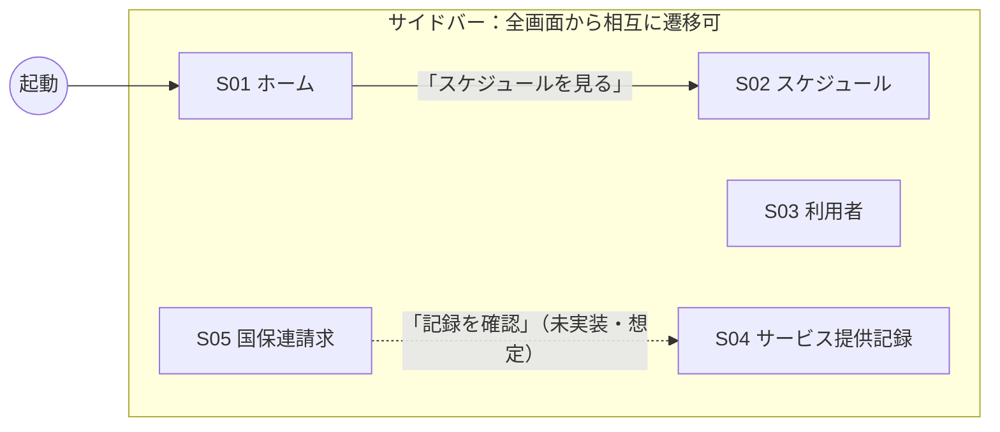
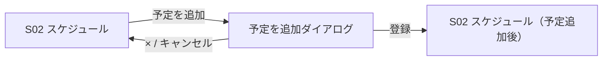
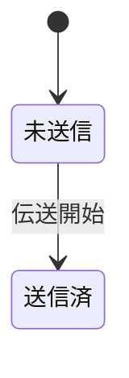

# 画面遷移仕様書

つむぎケア（訪問介護事業所向け業務アプリ・サンプル）の画面構成と遷移を定義します。

- 対象: ブラウザアプリ（本リポジトリ）と Figma「med-app」の Screens ページ
- 想定ユーザー: 事業所の管理者・サービス提供責任者（例: 佐藤 美咲（管理者））
- 画面サイズ: 1440 × 900 を基準（Figma のフレームサイズと同じ）

> 本アプリはデモ用です。データはすべて `src/data/mock.ts` の固定データで、保存・送信などの操作はサーバーに送られません。

---

## 1. 画面一覧

| ID | 画面名 | ルート | Figma フレーム | 役割 |
| --- | --- | --- | --- | --- |
| S01 | ホーム | `#/` | ホーム | 当日の状況把握（KPI・訪問予定・お知らせ） |
| S02 | スケジュール | `#/schedule` | スケジュール | 職員ごとの訪問予定をタイムラインで確認 |
| S03 | 利用者 | `#/clients` | 利用者 | 利用者の検索・一覧 |
| S04 | サービス提供記録 | `#/records` | サービス提供記録 | 訪問ごとの実施記録の入力・確定 |
| S05 | 国保連請求 | `#/billing` | 国保連請求 | 請求年月ごとの明細書の出力・伝送 |

- ルーティングは `HashRouter` を使います（静的ホスティングでもそのまま動くように）。
- 定義されていないルートでは何も表示されません（404 画面はありません）。

---

## 2. 共通レイアウト

全画面で次のレイアウトを共有します（`src/main.tsx` の `Layout`）。

```
┌──────────┬───────────────────────────────────────┐
│ Sidebar  │ Page Header（画面タイトル / 日付 / 通知） │
│          ├───────────────────────────────────────┤
│ ・ロゴ    │                                       │
│ ・事業所  │            Content（各画面）             │
│ ・ナビ×5  │                                       │
│ ・ヘルプ  │                                       │
│ ・ユーザー │                                       │
└──────────┴───────────────────────────────────────┘
```

- **Sidebar**（幅 240px）: ナビゲーション項目は 5 つ。表示中の画面の項目がアクティブ表示（`bg/brand-subtle` 背景 + `text/brand` 太字）になります。
- **Page Header**（高さ 64px）: 画面タイトルを表示します。日付・通知ボタンは表示のみです。
- **事業所切り替え・ヘルプ・ユーザー表示**: 表示のみで、操作しても遷移しません。

---

## 3. 遷移図



- 実線: 実装済みの遷移
- 点線: UI 上にボタンはあるが、まだつながっていない遷移（想定している遷移先）

### 3.1 グローバル遷移（サイドバー）

| 操作 | 遷移先 |
| --- | --- |
| 「ホーム」をクリック | S01 `#/` |
| 「スケジュール」をクリック | S02 `#/schedule` |
| 「利用者」をクリック | S03 `#/clients` |
| 「サービス提供記録」をクリック | S04 `#/records` |
| 「国保連請求」をクリック | S05 `#/billing` |

Figma のプロトタイプでも同じ遷移を設定しています（各画面のサイドバー項目 → 対象フレーム、On click / Navigate）。フローの開始画面は「ホーム」です。

---

## 4. 画面ごとの仕様

### S01 ホーム `#/`

**表示内容**

| エリア | 内容 |
| --- | --- |
| KPI カード ×4 | 本日の訪問（12 件）／記録の未入力（3 件）／10月分 請求予定額（1,284,300 円）／要対応（2 件） |
| 本日の訪問予定 | 時間・利用者・サービス・担当・状況のテーブル（6 件） |
| お知らせ | 区分バッジ（要対応 / 期限 / お知らせ）+ 日付 + 本文 |

**操作と遷移**

| 操作 | 結果 |
| --- | --- |
| 「スケジュールを見る」 | S02 スケジュールへ遷移 |
| KPI カード・テーブルの行・お知らせ | 表示のみ（遷移なし） |

**状況バッジの対応**

| 状況 | Badge Tone |
| --- | --- |
| 完了 | Success |
| 訪問中 | Info |
| 予定 | Neutral |
| 未記録 | Warning |

---

### S02 スケジュール `#/schedule`

**表示内容**

- ツールバー: 表示単位の切り替え（職員 / 利用者）、期間の切り替え（日 / 週）、グループ選択、日付送り（前日・今日・翌日）、「予定を追加」
- タイムライン: 縦に職員 5 名、横に 8:00〜18:00（1 時間ごとの区切り）。訪問予定を Schedule Block で表示
- 凡例: 身体介護 / 生活援助 / 身体・生活、未割当件数

**操作と遷移**

| 操作 | 結果 |
| --- | --- |
| 職員 / 利用者 の切り替え | 選択状態だけが切り替わる（タイムラインの内容は職員表示のまま） |
| 日 / 週 の切り替え | 選択状態だけが切り替わる（表示は日単位のまま） |
| グループ選択・日付送り | 表示のみ（未実装） |
| 予定を追加 | コードは未実装。Figma ではデザイン済み（下記「予定を追加ダイアログ」） |
| Schedule Block にカーソルを合わせる | ツールチップで「時間 利用者（サービス種別）」を表示 |

**Schedule Block の配置ルール**

- 左位置 = （開始時刻 − 8:00）÷ 10 時間 × タイムラインの幅
- 幅 = 所要時間 ÷ 10 時間 × タイムラインの幅（前後 2px ずつ余白）
- 色はサービス種別で決まる（身体介護 = 青、生活援助 = 緑、身体生活 = 紫）

#### 予定を追加ダイアログ（Figma のみ・コード未実装）

Figma フレーム: `スケジュール / 予定を追加（ダイアログ）`、`スケジュール / 予定追加後`

| 入力項目 | 種類 | 例 |
| --- | --- | --- |
| 日付 | セレクト | 2026/11/09（月） |
| 繰り返し | セレクト | なし |
| 職員 | セレクト | 田中 良子（サービス提供責任者） |
| 利用者 | 検索 | 高橋 和子（タカハシ カズコ）・要介護2 |
| サービス種別 | セグメント | 身体介護 / 生活援助 / 身体生活 |
| 開始時刻 / 終了時刻 | セレクト | 16:00 / 17:00（所要時間は自動表示） |
| メモ | 複数行テキスト（任意） | |

- 職員と時間を選ぶと、空き状況を表示する（例: 「田中 良子さんのこの時間帯に、ほかの予定はありません」）
- ×・キャンセル: ダイアログを閉じる
- 登録: ダイアログを閉じてスケジュールに戻り、追加した予定をタイムラインに表示。画面下部に「予定を追加しました」のトーストを表示



---

### S03 利用者 `#/clients`

**表示内容**

- ツールバー: 検索（氏名・フリガナ）、要介護度での絞り込み、担当職員での絞り込み、「CSV出力」「利用者を追加」
- 利用者一覧: 利用者（アバター + 氏名 + フリガナ）、要介護度、担当ケアマネ、担当職員、住所、次回訪問、状態。右上に件数（全 N 件）

**操作と遷移**

| 操作 | 結果 |
| --- | --- |
| 検索欄に入力 | 氏名またはフリガナに部分一致する利用者だけを表示。件数も連動して変わる |
| 要介護度：要支援 / 要介護 | 要介護度が該当する利用者だけを表示 |
| 担当職員の絞り込み | 表示のみ（選択肢は「すべて」だけ） |
| CSV出力・利用者を追加・行クリック | 表示のみ（未実装） |

**状態バッジの対応**

| 状態 | Badge Tone |
| --- | --- |
| 利用中 | Success |
| 入院中 | Warning |
| 休止 | Neutral |

要介護度は Badge `Tone=Brand` で表示します。

---

### S04 サービス提供記録 `#/records`

**表示内容**

- 左: 本日の訪問リスト（利用者名・時間・サービス・状況バッジ）。選択中の行は `bg/brand-subtle` 背景 + 左側にオレンジのバー
- 右: 記録フォーム
  - ヘッダー: 利用者名、要介護度バッジ、状況バッジ、記録者
  - 訪問情報: サービス提供日、開始時刻、終了時刻、サービス種別
  - バイタル: 体温、血圧、脈拍、顔色・様子
  - 実施内容: 身体介護（6 項目）、生活援助（4 項目）のチェックボックス
  - 特記事項: 複数行テキスト
  - 操作: 「下書き保存」「記録を確定」

**操作と遷移**

| 操作 | 結果 |
| --- | --- |
| 左リストの行をクリック | 右のフォームが選択した訪問の内容に切り替わる（画面遷移なし） |
| チェックボックス | オン / オフが切り替わる |
| 入力欄 | 入力できる（保存はされない） |
| 下書き保存・記録を確定 | 表示のみ（未実装） |

**初期状態**: 2 件目（高橋 和子・未記録）を選択した状態で開きます。

---

### S05 国保連請求 `#/billing`

**表示内容**

- 請求年月の選択（前月・翌月ボタン + セレクト）。翌月ボタンは無効表示
- 注意バナー: 「未確定のサービス提供記録が 3 件あります。」+「記録を確認」
- 国保連請求カード
  - 操作: 「様式出力」「伝送詳細を確認」「伝送開始」
  - テーブル: 書類（明細書名 + 事業所番号）、サービス提供年月、様式、件数（リンク表示）、伝送状況
  - 「伝送状況を取得」
- 地域包括支援センター提出分カード: 「様式出力」

**操作と遷移**

| 操作 | 結果 |
| --- | --- |
| 伝送開始 | 全行の伝送状況が「未送信」（Neutral）から「送信済」（Success）に変わり、伝送開始ボタンが無効になる |
| 記録を確認 | 想定の遷移先は S04 サービス提供記録（現在は未実装） |
| 請求年月の切り替え・様式出力・伝送詳細を確認・件数リンク・伝送状況を取得 | 表示のみ（未実装） |

**状態遷移（伝送状況）**



---

## 5. 未実装の操作（今後の拡張候補）

| 画面 | 操作 | 想定する動作 |
| --- | --- | --- |
| 共通 | 事業所切り替え | 事業所を選ぶと全画面のデータが切り替わる |
| 共通 | 通知ボタン | お知らせ一覧をポップオーバーで表示 |
| S02 | 職員 / 利用者、日 / 週 | タイムラインの軸・期間を切り替える |
| S02 | 予定を追加 | 登録ダイアログ（Figma でデザイン済み。コードに実装する） |
| S02 | Schedule Block のクリック | 同じダイアログで予定を編集 |
| S03 | 行クリック | 利用者詳細画面（新規） |
| S03 | 利用者を追加 | 利用者登録画面（新規） |
| S04 | 記録を確定 | 状況を「完了」に更新し、ホームの未記録件数に反映 |
| S05 | 記録を確認 | S04 へ遷移し、未確定の記録だけを表示 |
| S05 | 件数リンク | 対象の明細一覧を表示 |
